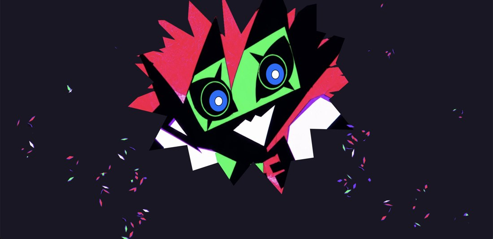
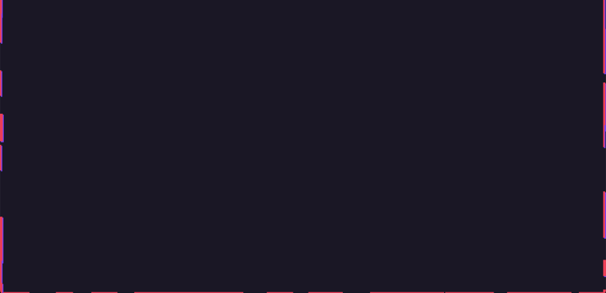
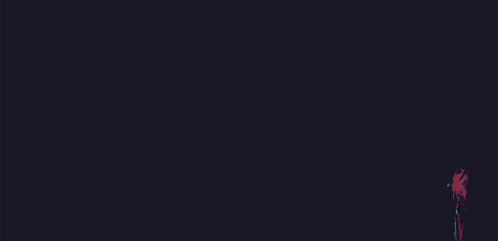
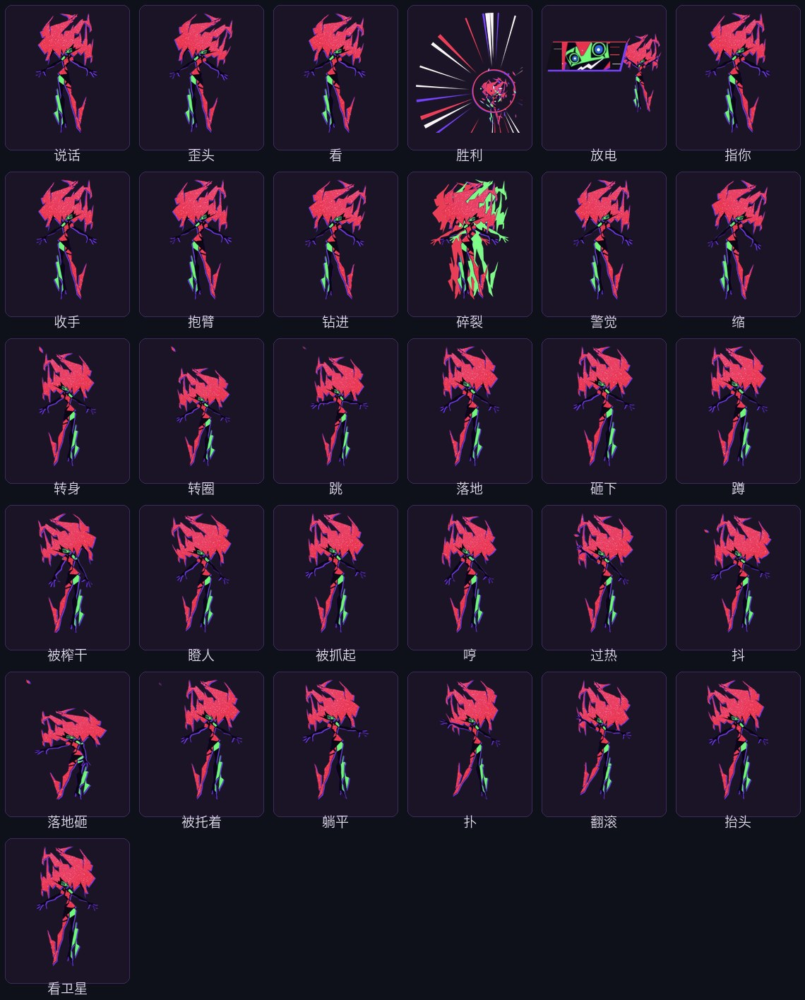

# 摩羯 · DSH 桌面挂件

<p align="center">
  
</p>

<p align="center">
</p>

<p align="center">
  <b>把 DeepSeek Harness 的桌面伴侣做成真的：中文、会坐窗口、会附身、会看卫星。</b>
</p>

<p align="center">
  <a href="https://github.com/Sophia-Pro/dsh-mojie-desktop/releases"></a>
  
  
  
</p>

<p align="center">
  <a href="https://github.com/Sophia-Pro/dsh-mojie-desktop/releases/download/v0.1.0/MoJie-0.1.0-macOS-arm64.zip"><b>⬇ 挂件（macOS arm64，98MB）</b></a>
  ·
  <a href="https://github.com/Sophia-Pro/dsh-mojie-desktop/releases/download/v0.1.0/MoJie-DSH-Plugin-0.1.0.zip"><b>⬇ DSH 插件（9KB）</b></a>
</p>
<p align="center">
  <a href="使用说明.md">使用说明</a>
  ·
  <a href="玩法.md">玩法与动画</a>
  ·
  <a href="NOTICE.md">来源与致谢</a>
</p>

---

## 她做什么


## 会动的

**开场** —— 三种随机：抓屏幕的大近景 / 大头照「嗨」/ 小动作入场。

<p align="center"></p>

**全屏附身** —— 整块屏幕变成她的脸，两秒后松开。

<p align="center"></p>

**附身窗口** —— 坐久了钻进去，整扇窗长满她的眼睛和锯齿嘴：


**全屏附身** —— 整块屏幕变成她的脸，两秒后松开：


**看卫星** —— 她抬头、夜空铺开、卫星划过、红光照上去：


**开场动画**（三套随机）：大头照「嗨」/ 双手撑住屏幕边缘的大近景 / 小动作入场。


## 所有动画

37 个动作、三种开场、附身/全屏附身/看卫星这些大场面，以及每一个怎么触发，都写在全表里了：

<p align="center"></p>

**[→ 玩法与动画一览](玩法.md)**

## 和 DSH 的关系

`dsh-plugin/` 是桥插件：装进 DeepSeek Harness 后，DSH 里新的一轮、某个工具、等你批准、干完、烧了多少 token，都会变成她的话和动作（面板里那个「琢磨：…」就是她看见你在想什么）。

从 [Release](https://github.com/Sophia-Pro/dsh-mojie-desktop/releases/tag/v0.1.0) 下 `MoJie-DSH-Plugin-0.1.0.zip` 解压，或者直接用仓库里的 `dsh-plugin/`：

```bash
cd dsh-plugin && npm install
dsh plugin --profile desktop add link:"$PWD"
```

装完重启一次 DSH。她的挂件也可以独立运行，不装插件只是少这些联动。

## 快速开始（从源码跑）

```bash
git clone https://github.com/Sophia-Pro/dsh-mojie-desktop.git
cd dsh-mojie-desktop
npm install
npm start                    # 先看能不能出人

./scripts/capri-build.sh . ~/Applications/摩羯.app   # 打包成 .app
```

完整说明见 [使用说明.md](使用说明.md)，动画和玩法细表见 [玩法.md](玩法.md)：托盘菜单每一项、双击/单击、音效、跟随 DSH 启停、常见问题。

## 特性一览

- **窗口交互**：坐上沿 / 骑窗 / 掉下来 / 附身 / 全屏附身；视频和全屏应用不坐
- **自适应**：按屏幕分辨率和缩放自动算大小；显示器增删、分辨率变化会重新收进可视区
- **互动**：单击随机说话（余额 / token / 进度 / 闲话），双击从所有动画里随机演一段（没演过的优先）
- **演技**：37 个动作（含从上游移植的蹲、瞪、被抱起、躺平、翻滚、过热…）、三种开场、全部音效为 Web Audio 实时合成
- **不抢焦点**：不占 Dock、不进 Cmd-Tab，点她不会把整个程序提到前台
- **中文化**：界面、台词、托盘、气泡全中文

## 版权

二次开发项目，原作 [mochiiwuff/capri-desktop](https://github.com/mochiiwuff/capri-desktop)，基于 [Stefanospi/Carpi-Evolution](https://github.com/Stefanospi/Carpi-Evolution)。来源、改动清单与致谢见 [NOTICE.md](NOTICE.md)。

许可证沿用上游：可自由使用、修改、分发，**不得售卖或用于付费服务**。角色与美术素材版权属于原权利人，本项目为同人作品。
